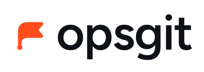
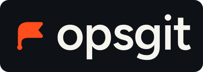

# opsgit brand

The mark is a pennant on a pole that starts at a commit node. The pole curves the way a branch line does in a git graph. Read it as: a change is committed, the branch carries it, the flag ships.

<p>
  
  &nbsp;&nbsp;
  
</p>

## Files

| File | Use it for |
| --- | --- |
| `mark.svg` | The symbol in signal orange. Default choice on light or dark backgrounds. |
| `mark-ink.svg`, `mark-paper.svg` | Single-ink versions for one-colour contexts (print, embossing, monochrome UIs). |
| `mark-outline.svg` | Line version for icon sets where the solid flag would be too heavy. |
| `lockup-light.svg`, `lockup-dark.svg` | Mark plus wordmark on a transparent ground. Light is for light backgrounds, dark for dark ones. |
| `wordmark-ink.svg`, `wordmark-paper.svg` | Wordmark alone, when the mark is already on screen. |
| `favicon.svg` | Mark on an ink tile. Browser tabs, GitHub org avatar. |
| `app-icon.svg` | Ink mark on a signal tile, 512 px. App stores, Slack, anywhere that wants a filled square. |
| `social.png` | 1280×640 social preview for the GitHub repo and link unfurls. |

In a GitHub README, show the right lockup for the viewer's theme:

```html
<picture>
  <source media="(prefers-color-scheme: dark)" srcset="brand/lockup-dark.svg">
  
</picture>
```

## Colour

| Name | Hex | Role |
| --- | --- | --- |
| Signal | `#FF4D1C` | The flag. Accent for links, active states, the mark. Never for body text. |
| Ink | `#0E1116` | Dark ground and text on paper. |
| Paper | `#F6F4EF` | Light ground and text on ink. Warm, not pure white. |
| Slate | `#8B8F96` | Secondary text, captions, borders. |

Signal is the only hue. Everything else is ink, paper, and greys between them. Semantic colours for enabled, disabled, and stale states in UI should be drawn from the same family: signal for "on", slate for "off".

## Type

The wordmark is **Figtree SemiBold**, lowercase, letter-spaced at −2%. It is already converted to outlines in the SVGs, so no font needs to be installed to use them.

For the website, product UI, and docs, use Figtree for headings and Inter for body text. Both are on Google Fonts. Code is whatever monospace the surface already uses.

## Spacing and sizing

- Keep clear space around the lockup equal to the height of the mark's pole.
- Do not show the mark smaller than 16 px. The favicon tile handles the smallest sizes.
- The mark sits on the x-height band of the wordmark, not centred on the cap height. The lockup files already do this.

## Don't

- Don't recolour the mark outside signal, ink, or paper.
- Don't put the mark on a signal background. Use `app-icon.svg`, which flips it to ink.
- Don't add a gradient, shadow, or outline to the flag.
- Don't set the wordmark in another typeface, or in Title Case.
- Don't use the flag as a pin, checkbox, or bookmark icon inside the product. It is the brand, not a glyph.

## Regenerating

The SVGs are generated with a short Python script using fontTools. The wordmark path is Figtree at weight 600 with the font's own kerning applied. If the wordmark text or weight changes, regenerate rather than editing the path by hand.

The website lives in [`site/`](../site/) and uses the same mark inline, with the wordmark set live in Figtree.
